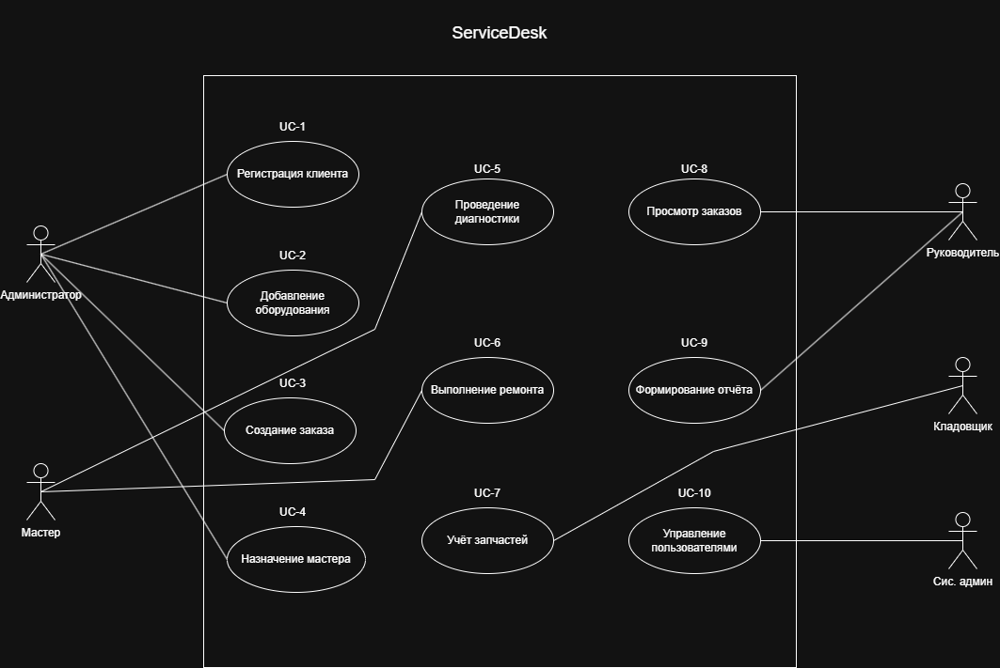
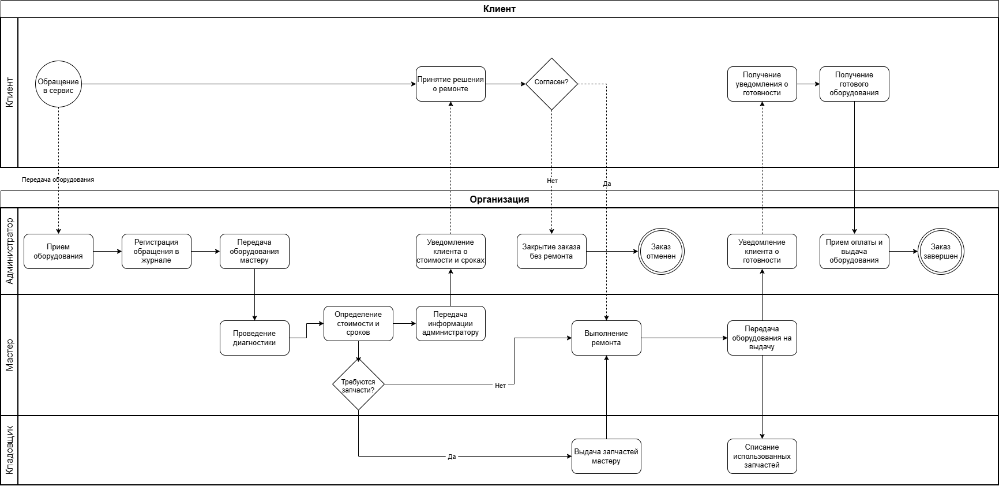
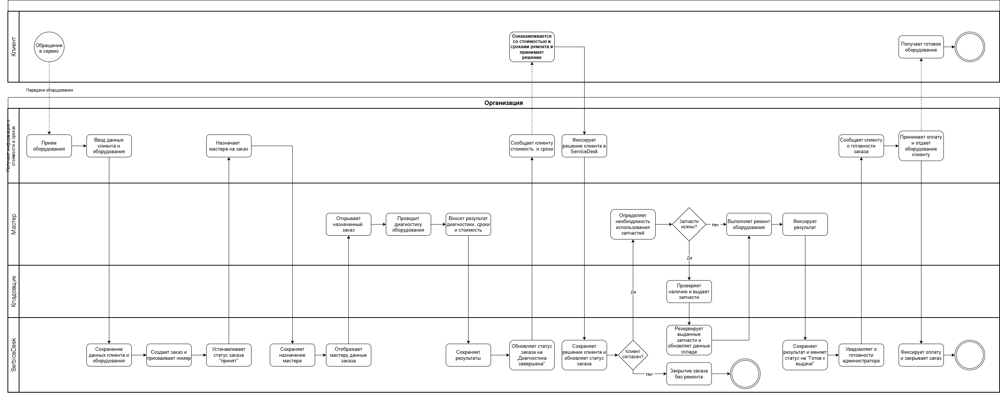
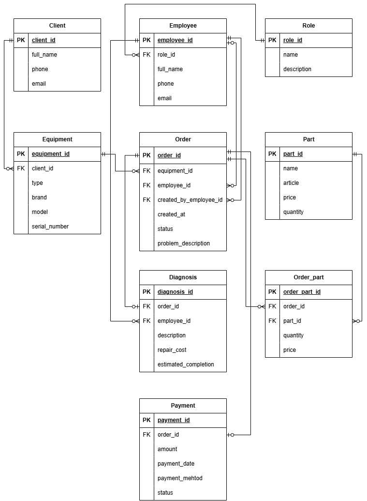

# ServiceDesk

## Содержание

- [О проекте](#о-проекте)
- [Функциональные возможности](#функциональные-возможности)
- [Архитектура и технологии](#архитектура-и-технологии)
- [Проектирование и системный анализ](#проектирование-и-системный-анализ)
- [Реализация](#реализация)
- [Диаграммы и модели](#диаграммы-и-модели)
- [Примеры работы API](#примеры-работы-api)
- [Результаты проекта](#результаты-проекта)
- [Структура проекта](#структура-проекта)

## О проекте

**ServiceDesk** - информационная система для автоматизации работы сервисного центра по ремонту техники.

Проект охватывает основные процессы сервисного центра: регистрацию клиентов и оборудования, оформление заказов на ремонт, проведение диагностики, учет запчастей и регистрацию платежей.

Цель проекта - разработать систему, которая упрощает управление заказами, обеспечивает централизованное хранение информации и помогает контролировать основные процессы обслуживания клиентов.

## Функциональные возможности

- **Клиенты и оборудование** - регистрация клиентов и учет принадлежащей им техники.
- **Заказы на ремонт** - создание, просмотр, изменение и управление заказами.
- **Сотрудники** - хранение информации о сотрудниках и их ролях.
- **Диагностика** - фиксация результатов диагностики, стоимости и предполагаемых сроков ремонта.
- **Учет запчастей** - ведение справочника запчастей и контроль складских остатков.
- **Комплектация заказов** - добавление запчастей в заказ с автоматическим изменением складских остатков.
- **Платежи** - регистрация и хранение информации об оплате заказов.

## Архитектура и технологии

Проект реализован с использованием клиент-серверного подхода. Backend предоставляет REST API для взаимодействия с реляционной базой данных PostgreSQL.

| Технология | Назначение |
|---|---|
| Python 3.15 | Основной язык программирования |
| FastAPI | Разработка REST API |
| PostgreSQL | Реляционная база данных |
| Psycopg | Взаимодействие с PostgreSQL |
| OpenAPI | Описание интерфейса API |
| Swagger UI | Интерактивная документация и тестирование API |

## Проектирование и системный анализ

В рамках проекта выполнены следующие задачи:

- **Сбор и анализ требований** - определение функциональных требований и целей автоматизации.
- **Анализ предметной области** - описание бизнес-сущностей, процессов и взаимосвязей.
- **Stakeholder Analysis** - выявление и анализ заинтересованных сторон.
- **User Stories** - формирование пользовательских историй и определение потребностей пользователей.
- **Use Case Modeling** - описание вариантов использования системы и сценариев взаимодействия с ней.
- **UML** - моделирование системы с использованием диаграммы вариантов использования (Use Case Diagram).
- **BPMN 2.0** - моделирование бизнес-процессов AS-IS и TO-BE, анализ текущего и целевого состояний процессов.
- **Gap Analysis** - выявление различий между текущими и целевыми бизнес-процессами.
- **ER-моделирование** - проектирование концептуальной и логической структуры базы данных, разработка ER-диаграммы.
- **Data Modeling** - определение сущностей, атрибутов, первичных и внешних ключей, кардинальности и связей между таблицами.
- **Data Dictionary** - описание структуры данных, атрибутов и их характеристик.
- **SQL** - разработка DDL-скриптов для создания структуры базы данных и подготовка тестовых данных.
- **REST API Design** - проектирование интерфейсов взаимодействия между компонентами системы.
- **API Documentation** - описание endpoints, HTTP-методов, параметров запросов и ответов с использованием OpenAPI и Swagger UI.
- **Test Case Design** - разработка тест-кейсов для проверки функциональности API и обработки ошибок.

## Реализация

В рамках разработки проекта реализованы следующие компоненты:

- **Разработка серверной части** - создание backend-приложения на Python с использованием FastAPI.
- **REST API** - реализация CRUD-операций (Create, Read, Update, Delete) для управления клиентами, оборудованием и заказами.
- **Проектирование и создание БД** - реализация реляционной базы данных PostgreSQL на основе разработанной ER-модели.
- **SQL** - написание запросов с использованием JOIN, ограничений целостности и операций изменения данных.
- **Интеграция с БД** - настройка взаимодействия backend-приложения с PostgreSQL с использованием Psycopg.
- **Бизнес-логика** - реализация бизнес-правил, проверок связей между сущностями и обработки конфликтов при выполнении операций.
- **Учет складских запасов** - реализация списания и возврата запчастей при добавлении и удалении их из заказов.
- **Обеспечение целостности данных** - использование первичных и внешних ключей, ограничений UNIQUE и CHECK.
- **Документирование API** - автоматическая генерация документации на основе OpenAPI с использованием Swagger UI.
- **Тестирование API** - проверка HTTP-методов, корректности ответов сервера, обработки ошибок и основных бизнес-сценариев.
- **Подготовка тестовых данных** - разработка SQL-скриптов для заполнения базы данных тестовыми записями.

## Диаграммы и модели

В рамках проектирования системы разработаны следующие модели:

### Use Case Diagram

Диаграмма вариантов использования, отражающая основных акторов системы и доступные им функциональные возможности.

### BPMN AS-IS

Модель текущего бизнес-процесса сервисного центра, отражающая порядок выполнения операций до автоматизации.

### BPMN TO-BE

Модель целевого бизнес-процесса, демонстрирующая изменения после внедрения информационной системы ServiceDesk.

### ER Diagram

ER-диаграмма, отражающая структуру базы данных, основные сущности, их атрибуты и связи между ними.

## Примеры работы API

### Получение списка клиентов

"GET /clients"

Возвращает список зарегистрированных клиентов с основной контактной информацией.

### Создание заказа на ремонт

"POST /orders"

Позволяет зарегистрировать новый заказ на ремонт оборудования с указанием его описания и связанных данных.

### Добавление запчасти в заказ

"POST /order-parts"

Добавляет запчасть в заказ и автоматически обновляет ее остаток на складе.

### Получение информации о заказе

"GET /orders/{order_id}"

Возвращает информацию о заказе, включая сведения об оборудовании и клиенте.

Полное описание методов, параметров запросов и ответов представлено в [документации API](Documentation/api_documentation.md).

## Результаты проекта

В результате разработки ServiceDesk:

- Проведен системный анализ предметной области и сформированы требования к информационной системе.
- Смоделированы текущие и целевые бизнес-процессы сервисного центра с использованием BPMN 2.0.
- Разработаны UML- и ER-диаграммы.
- Спроектирована и создана реляционная база данных PostgreSQL.
- Реализован backend на Python с использованием FastAPI.
- Разработан REST API для работы с основными сущностями системы.
- Реализована бизнес-логика управления заказами, запчастями и складскими остатками.
- Подготовлена техническая документация и проведено тестирование API.

Проект объединил задачи системного анализа, проектирования баз данных и разработки серверной части информационной системы.

  
## Структура проекта

- **ServiceDesk/** - корневая директория проекта.
  - **documentation/** - техническая документация и материалы по тестированию.
    - api_documentation.md - описание REST API и доступных методов.
    - api_testing.md - тест-кейсы и результаты проверки API.
    - bpmn-analysis.md - анализ бизнес-процессов и изменений при автоматизации.
  - **requirements/** - материалы по анализу предметной области и сбору требований.
    - domain_description.md - описание предметной области.
    - stakeholders.md - анализ заинтересованных сторон.
    - use_cases.md - варианты использования системы.
    - user_stories.md - пользовательские истории.
  - **backend/** - серверная часть приложения.
    - api.py - реализация REST API на FastAPI.
    - database.py - подключение и взаимодействие с PostgreSQL.
  - **database/** - SQL-скрипты для создания и заполнения базы данных.
    - schema.sql - структура таблиц, связей и ограничений базы данных.
    - seed.sql - начальное заполнение базы тестовыми данными.
  - **diagrams/** - графические модели и диаграммы проекта.
    - bpmn-as-is.drawio - исходная модель бизнес-процесса AS-IS.
    - bpmn-as-is.drawio.png - изображение модели AS-IS.
    - bpmn-to-be.drawio - целевая модель бизнес-процесса TO-BE.
    - bpmn-to-be.drawio.png - изображение модели TO-BE.
    - er-diagram.drawio - редактируемая ER-диаграмма базы данных.
    - er-diagram.drawio.png - изображение ER-диаграммы.
    - use-case-diagram.drawio.png - диаграмма вариантов использования системы.
  - README.md - основная информация о проекте и его реализации.

